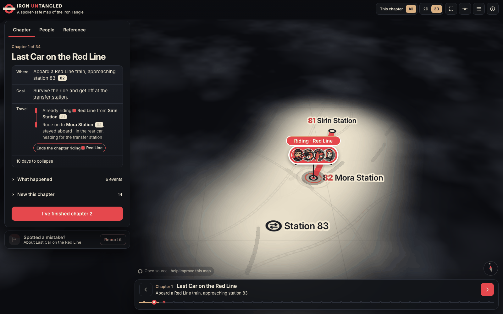

# Iron Untangled

An unofficial, spoiler-safe map and reading companion for *Dungeon Crawler Carl: The Dungeon Anarchist's Cookbook* by Matt Dinniman.

**Open it at [ironuntangled.app](https://ironuntangled.app)**

[](https://ironuntangled.app)

Tell it which chapter you have finished and it draws the floor, the Iron Tangle, as the book has revealed it so far, with a short recap, a codex of people, places and terms, and the party's route. Everything you have not read yet stays under fog. Looking back at earlier chapters is free; moving forward is a deliberate press-and-hold.

This README is spoiler-free, apart from the screenshot above, which shows the map after chapter 1. Issues and pull requests are not: they discuss the book chapter by chapter.

> **Unofficial fan project.** Iron Untangled is not affiliated with, or endorsed by, Matt Dinniman or any publisher of the series. The book, its world and its characters belong to their author and publisher. All book-related text in this project is our own paraphrase and commentary, never quoted book text. No cover art or fan art is included; the few portraits are original drawings made for this site.

## How spoilers are kept out

This is the one design rule every contributor needs to know, because the whole project depends on it.

1. **Every fact is tagged with a chapter.** `content/` is the source of truth. Each station, line, trip, recap beat, person, term and note carries the chapter at which the book reveals it.
2. **One bundle per chapter.** `npm run data` slices the content into `public/data/ch-NN.json`. A bundle holds only what a reader who has finished that chapter knows, including map coordinates, which are computed at build time. The browser fetches only bundles for chapters the reader has unsealed, and the app code itself contains no story content.
3. **A spoiler lint guards the bundles.** The same step fails if any bundle carries a later chapter's stamp, names an entity before its reveal (including through another entry's prose), or contains an embargoed term. It runs automatically before every build.
4. **A rendered-page test guards the site.** `npm run test:spoilers` opens the built site in a real browser at every chapter, reads the page text, attributes and network requests, and checks them again after reading ahead and stepping back. It also scans the static files every visitor downloads.

If you change content or UI, keep all four intact. The details are in [CONTRIBUTING.md](CONTRIBUTING.md).

## Is the map accurate?

Facts come from the book, cross-checked against chapter summaries and the fan wiki. The layout is a schematic of our own, because the book never fixes compass positions: the only real coordinate is a station's number, mapped to distance from the centre and compressed so busy areas have room (`scripts/geometry.ts`). Corrections are very welcome.

## Quick start

Requires Node 24 (see `.node-version`).

```bash
npm install
npm run dev          # builds the chapter bundles, then starts Vite
```

To check a production build the way CI does:

```bash
npm run build        # spoiler lint + bundles, type-check, Vite build into dist/
npm run preview      # serves dist/ on http://localhost:4317
npm run test:spoilers  # in a second terminal; needs Playwright's Chromium
```

The first time you run the rendered-page test, install the browser with `npx playwright install chromium`. It visits every chapter, so it takes a few minutes.

## Scripts

| Script | What it does |
|---|---|
| `npm run data` | Runs the spoiler lint and writes one bundle per chapter to `public/data/`. |
| `npm run dev` | `data`, then the Vite dev server. |
| `npm run build` | `data`, then `tsc` (type-check), then `vite build` into `dist/`. |
| `npm run preview` | Serves `dist/` on port 4317. |
| `npm run test:spoilers` | Rendered-page spoiler test against `http://localhost:4317/` (or a URL passed as an argument). |
| `npm run deploy` | `build`, then `wrangler deploy`. |
| `npm run og` | Renders the social card `public/og.png` (from `scripts/og.html`) and the PNG app icons. Needs Playwright's Chromium. |

## Project layout

```
content/        The book, paraphrased and tagged by chapter (source of truth)
  types.ts      The content schema: what every entry looks like
  chapters.ts   Per-chapter recaps, goals and locations
  map.ts        Stations, lines and the party's trips
  people.ts     The cast and their whereabouts
  lore.ts       Rules of the floor, creatures, and embargoed terms
  glossary.ts   The book's jargon, with plain definitions
  …             Questions, diagrams, the station directory
scripts/
  build-data.ts Lint, then write the chapter bundles
  slice.ts      What a reader at chapter N may know (pure function)
  lint.ts       The spoiler lint
  e2e.ts        The rendered-page spoiler test (Playwright)
  og.ts         Renders the social card and app icons (og.html is the card)
  geometry.ts   Schematic map coordinates
src/            The app: UI, map rendering, styles
public/         Static files, response headers, the generated bundles
docs/           The README screenshot
wrangler.jsonc  Cloudflare Workers config
```

## Deploy your own copy

The site is served by Cloudflare Workers (`wrangler.jsonc`, `public/_headers`).

1. Fork the repository and change `name` in `wrangler.jsonc` (the official site's Worker is `iron-untangled`) to a Worker name of your own, and replace or remove the `routes` entry for the official domain. If the config declares other bindings or the Worker expects secrets, create your own equivalents or remove them. The official address also appears in `index.html` (canonical link, social tags), `public/robots.txt`, `public/sitemap.xml` and `public/_headers`; point those at your own.
2. From your machine: `npx wrangler login`, then `npm run deploy`.
3. Or let GitHub Actions deploy on every push to `main`: add the repository secrets `CLOUDFLARE_API_TOKEN` (a token with the "Edit Cloudflare Workers" permissions) and `CLOUDFLARE_ACCOUNT_ID`. The workflow in `.github/workflows/deploy.yml` runs the full checks first and only deploys if they pass.

## Reader reports

"Report an inaccuracy" in the app posts to `POST /api/feedback`, a small Worker script (`worker/index.ts`) that files a GitHub issue labelled `reader-report` and `chapter-N`, with the reader's text folded under "Spoilers up to chapter N". Only `/api/*` runs the script (`assets.run_worker_first` in `wrangler.jsonc`); everything else is still served as static assets. Without a token the endpoint answers `503 not_configured` and the form offers a prefilled GitHub issue instead.

- **Switch it on:** create a fine-grained GitHub token limited to this repository with **Issues: Read and write** (nothing else), then run `npx wrangler secret put GITHUB_TOKEN`. The repository comes from the `GITHUB_REPO` var in `wrangler.jsonc`.
- **Run it locally:** `npm run build`, put `GITHUB_TOKEN=<a token for a test repo>` in a `.dev.vars` file (git-ignored), then `npx wrangler dev`. To avoid touching GitHub at all, point the API at a local stub: `npx wrangler dev --var GITHUB_API:http://127.0.0.1:8792`.
- **Tests:** `npm run test:worker` type-checks the Worker and runs its unit tests (validation, sanitising, issue formatting, the handler with GitHub mocked) with `node --test`.

## Contributing

Found something wrong, or something the map should show? Please open an [issue](https://github.com/canalesb93/iron-untangled/issues) or a pull request at [canalesb93/iron-untangled](https://github.com/canalesb93/iron-untangled). Fact corrections are the most valuable contribution of all. Read [CONTRIBUTING.md](CONTRIBUTING.md) first: it explains how reveal chapters work and how to keep titles spoiler-free.

## Credits

Thanks to the Dungeon Crawler Carl community, whose shared work made this possible: the fan wiki (including its "Untangling the Iron Tangle" page), readers' chapter summaries, and the fan maps that served as inspiration. Facts cross-checked against those sources are restated in our own words. And thanks to Matt Dinniman for the books.

Ricardo Canales ([@canalesb93 on Threads](https://www.threads.com/@canalesb93)).

## Security and conduct

Please report vulnerabilities privately, as described in [SECURITY.md](SECURITY.md). Everyone taking part is expected to follow the [code of conduct](CODE_OF_CONDUCT.md).

## License

The code is released under the [MIT License](LICENSE). The written content under `content/` is original paraphrase and commentary, offered under CC BY 4.0; see [NOTICE](NOTICE) for what that does and does not cover.
